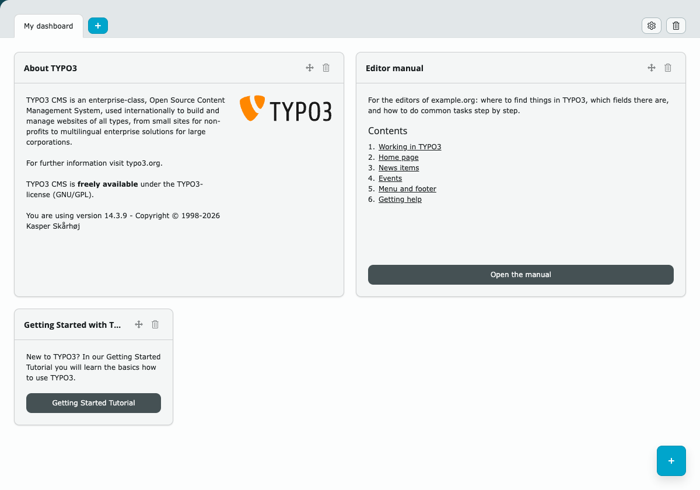
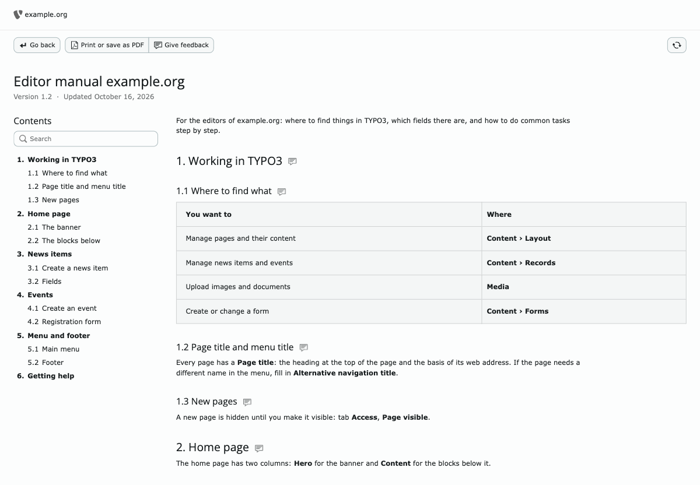
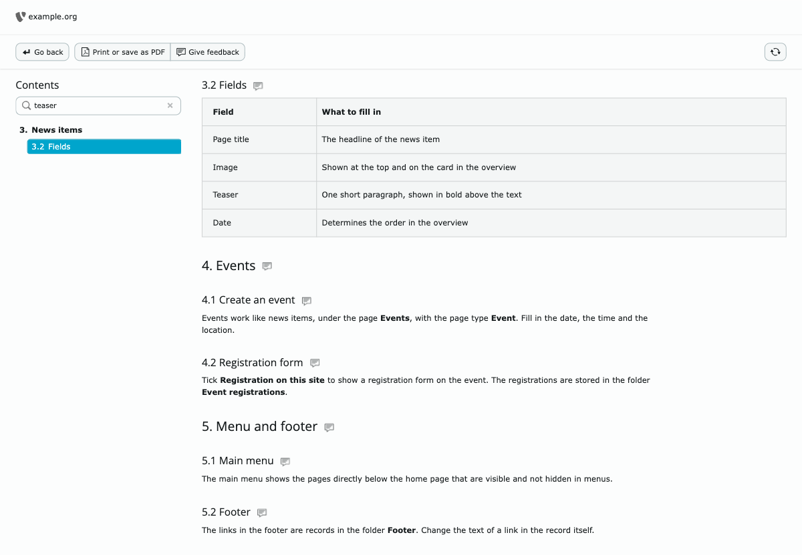

# TYPO3 extension `pn_backend_manual`

**The editor manual lives where editors work: in the TYPO3 backend.**

Every site you deliver, and every custom extension you build, could need a
manual: which page types there are, what each field does, how a plugin or
module works, where to find the news items. Usually that is a Word or PDF file
that gets mailed once at launch, ends up in someone's downloads folder and is
out of date after the first change. With this extension the manual is a
Markdown file in the sitepackage or the custom extension, right next to the
code it describes, and editors open it from their dashboard.

- **Always at hand.** A dashboard widget shows the introduction and the
  chapters; one click opens the full manual inside the backend. No searching
  through mail or intranet, no separate login.
- **Easy to look things up.** A table of contents next to the text that stays
  in view, a search field that filters it while you type, optional chapter
  numbers (1., 1.1) and sections, and a marker that shows where you are, like
  the selected page in the page tree.
- **Feedback from readers.** A feedback link next to every chapter and section
  sends a mail about that section, and the version and date under the title
  show how recent the manual is.
- **Kept up to date with the site.** The manual is a file in git. Change a
  content element and update its chapter in the same commit; it is reviewed and
  deployed together with the code, so the manual never lags behind.
- **Written in plain Markdown.** Headings, lists, tables, links and
  screenshots. It previews in your IDE and on GitHub or Bitbucket, and the same
  file can feed a Word export for the client's archive.
- **On paper too.** A print button prints the manual or saves it as PDF,
  without the backend around it, each chapter on a new page.
- **The right manual for the right people.** One widget per manual, so access
  is granted per backend group with the core setting *Allowed dashboard
  widgets*. A manual for editors and one for administrators is two widgets.
- **For sitepackages and custom extensions.** Any extension can ship its own
  manual: the sitepackage for the site as a whole, a custom extension for its
  own plugin, module or records. The manual travels with the extension, so it
  is there on every site that installs it.
- **Safe by design.** The request never chooses a file, raw HTML in the
  Markdown is stripped, and images are only served from `Resources/Public`.
- **Fits the backend.** Core styles and tokens, light and dark backend,
  keyboard and screen reader friendly; English, Dutch and German labels.

Example 'Editor manual' widget on the dashboard, with the introduction and the chapters:



The full view: version and date under the title, a search field above the
table of contents, and buttons to print or give feedback:



Searching for "teaser" leaves the chapter and the section that mention it; the
current section is marked:



All three show the example manual in
[`Documentation/Example/EditorManual.md`](Documentation/Example/EditorManual.md),
registered with `numbered: true`, `contentsDepth: 2` and a `feedback` address.

## Requirements

TYPO3 v14.3 LTS with `typo3/cms-dashboard` · PHP 8.3+ · `league/commonmark` ^2.10
(installed by Composer)

**Composer installations only.** The extension is also listed in the
[TER](https://extensions.typo3.org/extension/pn_backend_manual), but a classic
mode installation from there lacks `league/commonmark`: the widget and the full
view then show an error, and the log names the missing library.

## Installation

```bash
composer require proudnerds/pn-backend-manual
```

Then write a Markdown file in `Resources/Private/` of your sitepackage or
extension and register it as a dashboard widget in its `Services.yaml`.

## Documentation

The manual on docs.typo3.org explains every step and option:
**[docs.typo3.org/p/proudnerds/pn-backend-manual](https://docs.typo3.org/p/proudnerds/pn-backend-manual/main/en-us/)**

- [Adding a manual](https://docs.typo3.org/p/proudnerds/pn-backend-manual/main/en-us/AddingAManual.html):
  the Markdown file, how it is read, images
- [Configuration](https://docs.typo3.org/p/proudnerds/pn-backend-manual/main/en-us/Configuration.html):
  the widget registration and all options
- [Who sees which manual](https://docs.typo3.org/p/proudnerds/pn-backend-manual/main/en-us/Access.html)
- [The full view](https://docs.typo3.org/p/proudnerds/pn-backend-manual/main/en-us/FullView.html):
  table of contents, print or save as PDF
- [Writing tips](https://docs.typo3.org/p/proudnerds/pn-backend-manual/main/en-us/WritingTips.html)
- [Development](https://docs.typo3.org/p/proudnerds/pn-backend-manual/main/en-us/Development.html)

The source of that manual is in [`Documentation/`](Documentation/).

## Credits

Created and maintained by [ProudNerds](https://www.proudnerds.com/):
Jacco van der Post.

## License

GPL-2.0-or-later. See [LICENSE](LICENSE).
